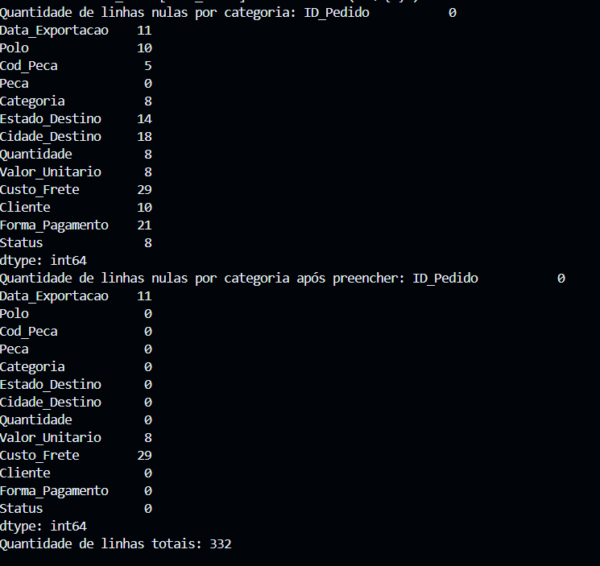
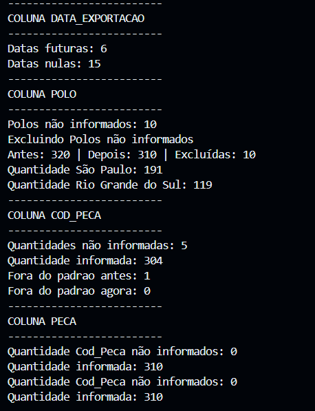
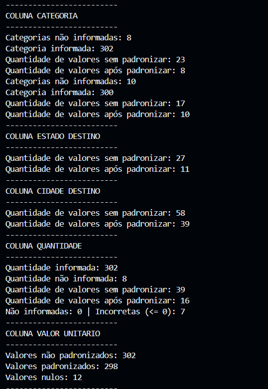
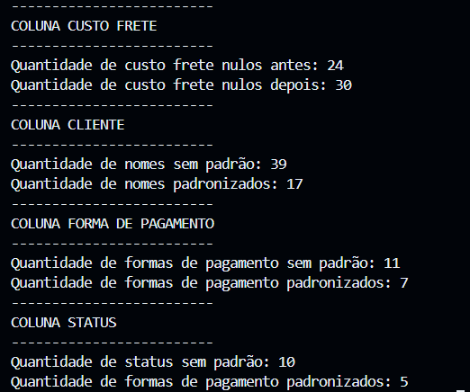
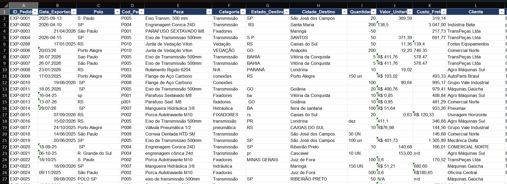
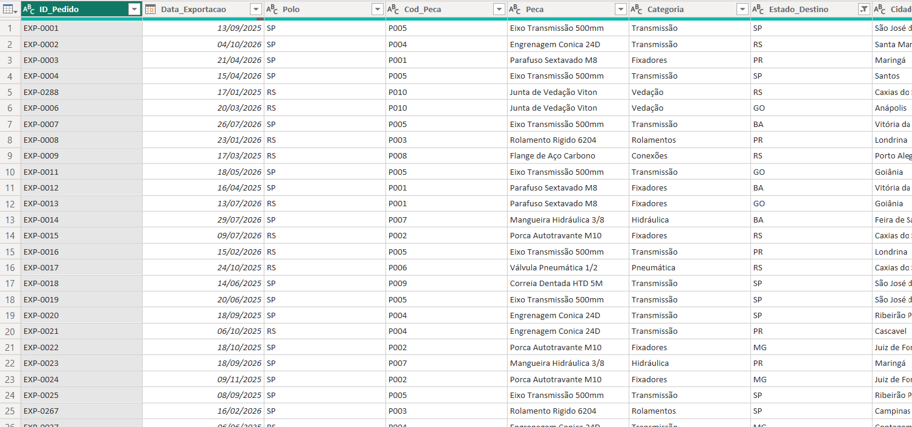
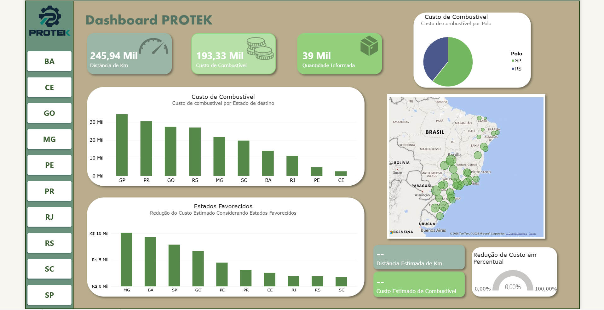
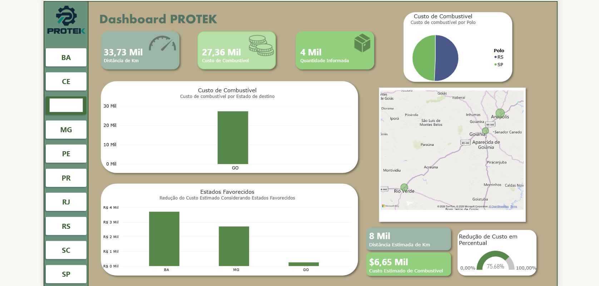

# Redução de custos PROTEK

PROTEK é uma empresa fictícia de produção  e exportação de peças, com seus polos em São paulo e Rio Grande do Sul. Após uma reunião foi definido escolher um estado para receber um novo polo visando diminuir a redução de custo de combustível pela exportação.

## Sobre o Projeto

Este projeto tem como objetivo analisar A diminuição em custo de combustível, utilizando dados para identificar padrões, avaliar indicadores e apoiar a tomada de decisões.

A análise foi desenvolvida com foco em visualizar qual polo será mais benefico para apadrinhar um novo polo, buscando compreender qual polo é mais vantajoso, quantidade gasta pelos polos atuais, quilometragem feita.

## Objetivos

- Analisar o custo de combustível pelos polos São Paulo e Rio Grande do Sul.

- Identificar padrões e oportunidades de melhoria.

- Comparar resultados entre regiões.

- Desenvolver uma visualização para facilitar a interpretação dos dados.

- Apresentar conclusões baseadas nos resultados obtidos.

## Tecnologias Utilizadas

| Tecnologia | Aplicação  
| --- | --- | 
| Python| Manipulação e análise dos dados | 
| Pandas | Tratamento, transformação e análise |
| Power Query | Preparação e transformação dos dados | 
| Power BI / PowerPoint | Visualização e apresentação dos resultados| 
| Git e GitHub | Versionamento e documentação do projeto |

## Etapas da Análise

### 1. Coleta dos Dados

Os dados são totalmente fictícios criados pelo Claude Code, as planilhas foram propositalmente feitas bagunçadas.

Os dados brutos estão intocados, a planilha original apenas é lida e os resultados são gerados em outro arquivo.

### 2. Tratamento dos Dados

Foram realizadas etapas de preparação dos dados, como:

- Identificação e tratamento de valores ausentes.

- Verificação de duplicidades.

- Padronização de informações.

- Transformação e criação de colunas.

- Criação de indicadores necessários para a análise.

- Recuperação por engenharia reversa. Códigos ausentes recuperados pelo nome da peça e categorias ausentes pelo código usando a coluna Cod_Peca como referência.

### 2.2 Tratamento em Power Query

Após a extração de planilha, foi visível organizar e tratar algumas informações. Como:

- Valor de colunas, como: Data, valor decimal
- Organizar Planilhas
- Duas linhas nulas que passaram despercebidas

### 2.3 DAX

Para o cálculo foi utilizado como suporte as colunas de status criadas, manténdo a veracidade e consistência dos dados

### 3. Análise Exploratória

Nesta etapa, foram investigados os dados para identificar padrões, comparar categorias e compreender os principais indicadores relacionados ao problema.

### 4. Visualização dos Dados

Os resultados foram apresentados por meio de gráficos, indicadores e filtros, permitindo explorar diferentes perspectivas da análise.

## Decisões

- Leitura do pandas utilizando (dtype= str) para o tipo das colunas serem um padrão, com a conversão ficando sob meu controle.

- Duplicatadas removidas com critério sendo da coluna ID_Pedido apenas, com o valor de linhas de 332 para 320, contendo 12 duplicidades.

- As colunas de Texto recebem o valor "Não informado" nos ausentes.

- Colunas numéricas e de data (Quantidade, Valor_Unitario, Data_Exportacao) ficam nulas, o "Não informado" aparece apenas no Power BI por meio de colunas de Status. Isso evita que os textos quebrem os cálculos

- Colunas adicionais (Quantidade_Status, Valor_Status) foram criadas, usadas de suporte para as colunas Quantidade e Valor_Unitario, conténdo linhas como Informado, Não informado ou Incorreto que alimentam o relatório de qualidade e rodapé do dashboard.

- Valor unitário não foi preenchido com cálculo. Mediana ou média seriam especulações sobre um dado que é um fato registrado, então o nulo permanece e a linha fica sem receita calculável, mantendo uma precisão maior dos relatórios.

- Datas foram convertidas com pd.to_datetime, fazendo o tipo da coluna ser de data e não texto.

- Polo padronizado com replace e listas de variações, método escolhido por ser simples de entender e manter. Porto alegre na coluna de polo foi tratado como RS.

- Linhas sem polo foram excluídas, pois sem a origem não há como calcular a distância. A quantidade excluída será informada.

- Estado e cidade padronizados com dicionários de variações. A cidade passou antes por .str.title().str.strip(), e as preposições (do, dos, de) foram corrigidas no dicionário.

- Quantidade padronizada com dicionário. Textos como 50 un e dez viram número, e - e não informados viram nulos, tendo a coluna Quantidade_Status como auxiliar.

- Valor unitário convertido de texto para número com uma regra simples: se há vírgula, os pontos são milhares e a vírgula é o decimal. Se não há, o ponto já é o decimal.

- Premissas do negócio e dos dados
Empresa e dados fictícios, gerados para praticar limpeza e análise.

- Dois polos existentes: São Paulo (SP) e Rio Grande do Sul (RS). As cidades-sede (São Paulo e Porto Alegre) são premissas.
Distâncias aproximadas, em km rodoviários, feitas sem mapa em tempo real e que devem ser validadas.

- Entrega dentro da cidade do polo fixada em 20 km.
Combustível: gasolina a R$ 6,60/litro (média nacional ANP de 24/07/2026) e consumo de 8 km/L, ambos premissas editáveis.

- Preço único para todos os estados, uma simplificação, e o custo considera só combustível (sem pedágio, motorista ou custo de construir o polo).

- A receita (Quantidade × Valor_Unitario) só é calculada quando os dois valores estão corretos, então o total por estado é um pouco subestimado.

- Quantidades <= 0 (-50, -10, 0): Não foram consideradas nas contas, sendo filtradas por DAX.

- Estados ausentes (N/D): Recuperados pela cidade em Power Query por ser uma quantidade pequena, mas considerando uma quantidade maior seria feita pelo pandas com engenharia reversa.

# Principais Resultados

Aqui serão apresentados os resultados do projeto, conténdo quantidade de valores nulos e antes e depois depois da padronização.

## Resultado 1
Contabilizando os valores nulos de cada coluna foi possível identificar a quantidade por coluna, sendo o primeiro tratamento. Custo_Frete e Valor_Unitário e Data_Exportação não foram preenchidos pois Data_Exportação é de tipo data e os outros são valores numéricos.

## Resultado 2
Por coluna foi possível identificar valores que não são nulos mas com informações indicando nulos. Para a Coluna Polo foi exclúido os valores não informados (Anteriormente nulos) pois sem eles não seria possível a análise.

Para a coluna Peca e Cod_Peca foram utilizados tratamentos de engenharia reversa, pois um código representava o nome de uma peça, então para resolver os valores que tinham não informados em uma coluna foi feito a busca por outro registro que continha o mesmo nome ou código. Os que tinham valores não informados em ambos foram excluídos no Power Query.

## Resultado 3

Coluna Categoria teve um aumento de não informado, isso aconteceu por conta de que existiam registros com valores que representavam nulos como "-" e "N/d" que foram contabilizados como informados, então após tratar eles corretamentes o número aumentou.

Para Cidade Destino e Estado Destino foram feitos os mesmos padrões com engenharia reversa igual ao Cod_Peca e Peca, mas isso no Power Query.

Quantidade e Valor Unitário tiveram seus nulos mantidos, pois foi criado colunas auxiliares de Status para avisar os erros e nulos, não adicionando valores de suposição.

## Resultado 4

Após a padronização é possível identificar que existiam vários registros sem padrão, tendo uma diminuição drástica de quantidade de valores inconsistêntes.

## Antes e depois

Antes:

Depois:

## Dashboard

--- 
# Conclusão

A análise permitiu identificar a importância de analisar, tratar os dados de forma correta e entender o objetivo central da análise para entregar o resultado mais acertivo possível.

Com base nos resultados, foi possível apresentar uma recomendação relacionada ao estado que deverá apadrinhar um novo polo, sendo este Goiás, pois levando em consideração os estados vizinhos beneficiados e seus números de gasto, foi possível comparar com outros estados usando a mesma métrica e visualizar que teria a maior porcentagem e número de gastos.

O projeto demonstrou como a utilização de dados pode contribuir para a análise de problemas e para a tomada de decisões.

---
# Como Executar o Projeto

## Pré-requisitos

Python instalado.

Git instalado.

Bibliotecas necessárias para a análise:

- Pandas
--- 
# Aprendizados

Durante o desenvolvimento, foram praticados:

- Manipulação e análise de dados.

- Tratamento e transformação de informações.

- Construção de indicadores.

- Desenvolvimento de visualizações.

- Interpretação de resultados.

- Documentação e organização de projetos.

--- 
# Autor

Cauã Garcia Gomes Barbosa

Estudante de Análise de Dados, desenvolvendo projetos com Python, SQL e ferramentas de visualização.

GitHub:GitHub: https://github.com/CauaGarcia277

LinkedIn: https://www.linkedin.com/in/cauagarcia